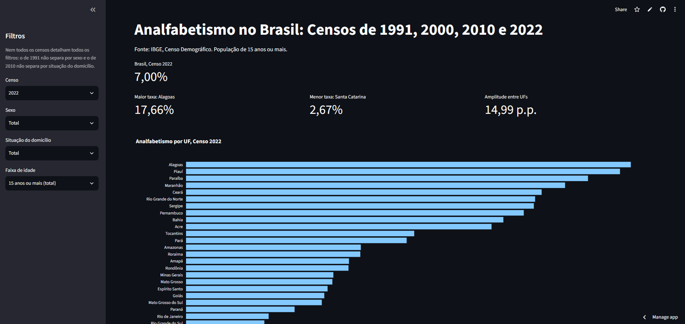
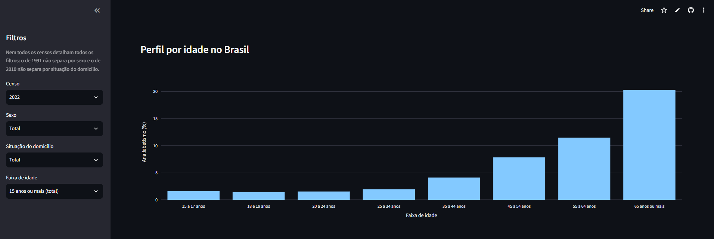

# Analfabetismo no Brasil: Censos de 1991, 2000, 2010 e 2022

## 1. Resumo

Este trabalho contempla o Projeto Final do Curso de Análise e Visualização de Dados, do Programa SCTec, e busca analisar a evolução e a desigualdade do analfabetismo no Brasil por unidade federativa (UF), região, idade e sexo. Para desenvolvimento, apresentação e análise foram utilizados dados dos Censos Demográficos de 1991, 2000, 2010 e 2022 do IBGE, com população de 15 anos ou mais. O projeto foi estruturado por meio do tratamento de dados em Python (ETL e análise exploratória), com a entrega de dashboard interativo desenvolvido em Streamlit, publicado online.

Como principais achados deste projeto, evidenciou-se como fato positivo a queda expressiva da taxa de analfabetismo de 20,07% em 1991 para 7,00% em 2022. Como ponto de atenção, foi identificada desigualdade entre UFs e regiões, a exemplo da taxa de analfabetismo de 17,66% em Alagoas, em contraste aos 2,67% em Santa Catarina no Censo de 2022, representando diferença de 14,99 pontos percentuais. Ainda, observou-se diferença entre homens e mulheres - no panorama geral, a taxa é maior entre homens. Entretanto, na faixa etária de 65 anos ou mais, a taxa de analfabetismo é maior em mulheres.

## 2. Problema e objetivo

A pergunta de análise definida foi: entre 1991 e 2022, a taxa de analfabetismo de pessoas com 15 anos ou mais no Brasil caiu de forma desigual entre as Unidades Federativas (UFs), regiões, sexos e as faixas etárias?

Assim, o objetivo do projeto foi analisar os dados de analfabetismo no Brasil, com base nos censos realizados, buscando evidenciar possíveis pontos críticos e hipóteses relacionadas às diferenças deste indicador entre as UFs, regiões, sexos e faixas etárias, apresentando um dashboard prático, tendo como público alvo gestores de educação e lideranças.

## 3. Escopo

Para direcionamento de análise, foram utilizados dados relativos ao analfabetismo no Brasil registrados nos quatro últimos censos, que são aplicados aproximadamente a cada 10 anos - 1991, 2000, 2010 e 2022. Como principais dados avaliados, foram utilizados: ano de realização do censo, grande região (Nordeste, Norte, Centro-Oeste, Sudeste e Sul), UF, faixa etária, sexo (as tabelas utilizadas não detalham em 1991) e situação de domicílio (as tabelas utilizadas não detalham em 2010).

Neste escopo, não foram feitas análises de causalidade, nem incluídos dados de investimento em educação, ficando como sugestão para uma próxima etapa de detalhamento.

## 4. Fonte dos dados e licença

* **Fonte:** IBGE, Censo Demográfico, acessado pelo SIDRA (Sistema IBGE de Recuperação Automática).
* **Tabelas:**
  * Censo 1991: Tabela 201 - População residente de 5 anos ou mais por alfabetização, situação e grupos de idade - [sidra.ibge.gov.br/Tabela/201](https://sidra.ibge.gov.br/Tabela/201)
  * Censo 2000: Tabela 1553 - População residente de 5 anos ou mais de idade por situação do domicílio, sexo, alfabetização e grupos de idade - [sidra.ibge.gov.br/Tabela/1553](https://sidra.ibge.gov.br/Tabela/1553)
  * Censo 2010: Tabela 7240 - População, total e indígena, de 15 anos ou mais de idade, por alfabetização, sexo, idade, quesito de declaração e localização do domicílio - [sidra.ibge.gov.br/Tabela/7240](https://sidra.ibge.gov.br/Tabela/7240)
  * Censo 2022: Tabela 10091 - Taxa de alfabetização da população, total e quilombola, de 15 anos ou mais de idade, por sexo, grupos de idade, localização e situação do domicílio - [sidra.ibge.gov.br/Tabela/10091](https://sidra.ibge.gov.br/Tabela/10091)
* **Como os dados foram obtidos:** as tabelas foram consultadas no SIDRA com seleção manual de variáveis, territórios, sexo, idade e situação, e baixadas em CSV. Os arquivos originais estão em `data/raw`, sem alterações.
* **Data de acesso:** a pesquisa e download dos arquivos foram realizados em 31/10/2026.
* **Licença e uso:** os dados do IBGE são públicos e estão citados com a fonte. São dados agregados, sem identificação de pessoas.

## 5. Pipeline e metodologia

O pipeline é executado em três etapas, cada uma em um módulo de `src/`:

1. **Extração (`extract.py`):** leitura dos quatro CSVs do SIDRA, que têm vários blocos e cabeçalhos em níveis.
2. **Transformação (`transform.py`):** conversão do formato largo para o longo, padronização de nomes e cálculo da taxa de analfabetismo.
3. **Carga e validação (`load.py`):** junção dos quatro censos em `data/processed/analfabetismo_censos.csv`, com verificações automáticas (sem duplicados, sem valores ausentes, taxas entre 0 e 100 e valores nacionais conferidos).

**Taxa de analfabetismo:** pessoas não alfabetizadas ÷ (alfabetizadas + não alfabetizadas) × 100, para população de 15 anos ou mais. Em 2022, o IBGE divulga a taxa de alfabetização, e a de analfabetismo foi calculada como 100 menos ela.

**Decisões de tratamento:**

- **Pessoas sem declaração (2010):** ficam fora do denominador.
- **Contagens antes das taxas:** quando faixas de idade foram agrupadas, as contagens foram somadas antes de calcular a taxa.
- **Faixas de idade:** em 2010, 15 a 17 e 18 e 19 anos foram obtidas somando idades simples, para ficarem iguais aos demais censos. A faixa de 75 anos ou mais está contida na de 65 anos ou mais.
- **1991:** o total de 15 anos ou mais foi calculado somando as faixas de idade, e a tabela não separa por sexo.
- **2010:** a tabela não separa por situação do domicílio.
- **2000:** foi usada a tabela do universo (1553), e não a da amostra, para o total nacional ficar coerente com os demais censos.

**Análise exploratória:** `notebooks/01_eda.ipynb` (evolução nacional, resumo por UF, regiões, perfil por idade). Medidas de desigualdade: amplitude (maior taxa menos menor taxa, em pontos percentuais) e razão máximo/mínimo.

## 6. Bibliotecas utilizadas

- Python: desenvolvido em 3.14.5; publicado com 3.12
- pandas 3.0.3, plotly 7.1.0, streamlit 1.66.1, scipy 1.18.0

## 7. Resultados

- **Evolução nacional:** a taxa caiu de 20,07% (1991) para 13,63% (2000), 9,62% (2010) e 7,00% (2022).
- **UFs:** em 1991, a maior taxa foi a de Alagoas (45,32%) e a menor a do Distrito Federal (9,24%), uma amplitude de 36,08 pontos percentuais (p.p.). Em 2022, Alagoas segue com a maior (17,66%) e Santa Catarina tem a menor (2,67%), amplitude de 14,99 p.p. A diferença absoluta diminuiu, mas a razão entre a maior e a menor taxa subiu de cerca de 4,9 para cerca de 6,6 vezes.
- **Regiões:** há evidência da desigualdade entre os estados e destaca-se a diferença entre regiões. Os estados com menores taxas de analfabetismo estão nas regiões Centro-Oeste, Sudeste e Sul, enquanto os estados com maiores taxas prevaleceram na região Nordeste. Ao verificar a região com maior taxa de analfabetismo (Nordeste) com a região de menor taxa (Sul), no último censo realizado (2022), a diferença caiu para 10,8 pontos em comparação aos 25,8 pontos identificados em 1991. Entretanto, a razão foi de 3,2 vezes em 1991 para 4,1 vezes em 2022, retratando aumento da desigualdade entre estas regiões.
- **Sexo:** no total, a taxa dos homens é maior em todos os censos disponíveis (2000: 13,77% contra 13,50%; 2010: 9,94% contra 9,32%; 2022: 7,51% contra 6,52%), e a diferença aumentou. Por idade, o quadro muda: entre 15 e 17 anos os homens têm taxa maior, e entre pessoas de 65 anos ou mais, a taxa das mulheres é a maior.
- **Idade:** o analfabetismo cresce com a idade nos dois extremos da série, e em 2022 as faixas jovens têm taxas bem menores que em 1991.
- **Situação do domicílio (65 anos ou mais, 2022):** em 2022, as taxas foram maiores em mulheres em ambas as situações de domicílio. No rural, homens 42,02% e mulheres 43,37%; urbano, homens 15,84% e mulheres 17,47%.

## 8. Discussão e limitações

- **Idade e gerações:** os censos não acompanham as mesmas pessoas. A comparação de uma faixa entre censos mostra mudança entre gerações.
- **Análise ecológica:** os dados são agregados por território, então os resultados descrevem grupos e não indivíduos.
- **Filtros incompletos:** 1991 não separa por sexo e 2010 não separa por situação do domicílio.
- **Diferença entre amplitude e razão:** a razão é sensível a taxas mínimas muito pequenas, e por isso as duas medidas são apresentadas.
- **Hipóteses não testadas:** as explicações para a diferença entre homens e mulheres (trabalho precoce dos meninos; menos oportunidades de estudo para mulheres mais velhas; fatores culturais) são hipóteses. Testá-las exigiria dados de ocupação e trabalho por sexo e idade.
- **Sem causalidade:** o projeto descreve padrões, não causas.
- **Próximos passos:** incorporar dados de investimento em educação (Portal da Transparência) para contextualizar a evolução.

## 9. Aplicação profissional

O painel ajuda gestores a ver onde e em quais idades o analfabetismo é mais alto, o que apoia a priorização de programas de educação de jovens e adultos. A inversão entre homens e mulheres entre os mais idosos **sugere** ações voltadas especificamente às mulheres mais velhas, em especial em áreas rurais.

## 10. Como executar

```bash
pip install -r requirements.txt
python -m src.load
python -m streamlit run app/streamlit_app.py
```

O segundo comando gera `data/processed/analfabetismo_censos.csv`, e o terceiro abre o aplicativo.

## 11. Estrutura de pastas

```
analfabetismo_brasil/
├── app/ aplicativo Streamlit
├── data/
│ ├── raw/ CSVs originais do SIDRA
│ └── processed/ tabela tratada
├── docs/ imagens do app Streamlit
├── notebooks/ análise exploratória
├── src/ extract.py, transform.py, load.py
├── requirements.txt
└── README.md
```

## 12. Estratégia de branches

- `main`: versão estável e publicada.
- `develop`: desenvolvimento, integrada à `main` antes do deploy.

Mensagens de commit curtas, no imperativo, em português.

## 13. Aplicativo publicado

Disponível pelo link: [dcbz2yfjmvhz3buoyzwrcr.streamlit.app](https://dcbz2yfjmvhz3buoyzwrcr.streamlit.app/)





## 14. Créditos e uso de IA

Projeto Final do curso Visualização de Dados e BI (SENAI/LAB365, Programa SCTec). Autora: Luana Majolo Haas. Dados: IBGE. Este trabalho contou com apoio de assistente de IA (Claude, da Anthropic) como orientação ao longo das etapas; a execução do código, as decisões e as interpretações são da autora, seguindo as sete etapas propostas para este projeto (escolha do tema; definição do problema; obtenção dos dados; análise com Python; criação do BI via Streamlit; documentação e publicação; apresentação com vídeo).

## 15. Links

- Repositório: [github.com/luana-mh/Projeto_final_curso_LuanaMajoloHaas_SCTec](https://github.com/luana-mh/Projeto_final_curso_LuanaMajoloHaas_SCTec)
- Aplicativo: [dcbz2yfjmvhz3buoyzwrcr.streamlit.app](https://dcbz2yfjmvhz3buoyzwrcr.streamlit.app/)
- Repositório da turma: [Projetos/Projeto_Final_do_Curso/Luana_Majolo_Haas](https://github.com/Visualizacao-Dados-BI-T1/Projeto_ZP/tree/main/Projetos/Projeto_Final_do_Curso/Luana_Majolo_Haas)
- Vídeo no LinkedIn: [PREENCHER]
- Trello: dispensado pelo professor para esta entrega.
